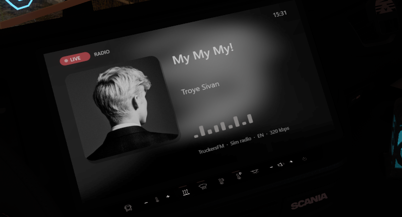
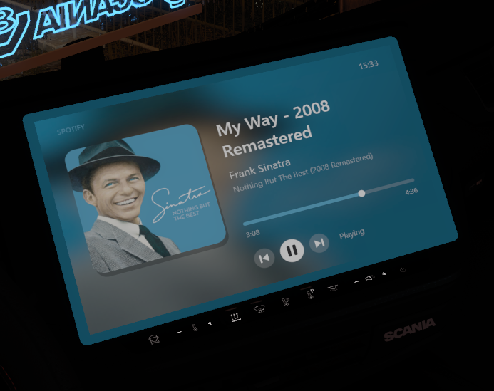

# EtsNowPlaying

**Sieh auf dem GPS-Display deines Trucks, was du gerade hörst** – in Euro Truck Simulator 2 und American Truck Simulator.
Das **Radio** im Spiel (Sender, Song, Interpret, Cover) oder **Spotify** (Cover, Titel, Interpret, Fortschritt), und du kannst
direkt in der Kabine auf Zurück / Pause / Weiter klicken.

*[English](README.md) · Deutsch*

  
  

## Das bekommst du

- **Radio:** Song, Interpret und Cover des Senders, den du im Spielradio hörst, dazu das Logo des Senders.
- **Spotify:** Cover, Titel, Interpret, Album, Fortschrittsbalken und Play/Pause – aus der Windows-Mediensteuerung,
  Spotify kann also im Hintergrund bleiben.
- **Schaltet selbst um:** Radio an → Radio, Radio aus → Spotify.
- **Klicken zum Steuern:** Zurück, Play/Pause und Weiter gehen mit der Maus, direkt auf dem Display.
- **Eine Datei.** Nichts weiter zu installieren. Funktioniert mit TruckersMP.

## Installieren

1. Spiel beenden.
2. **`EtsNowPlaying.dll`** von der Seite [Releases](../../releases) herunterladen.
3. In den `plugins`-Ordner des Spiels legen:  
   `...\Steam\steamapps\common\Euro Truck Simulator 2\bin\win_x64\plugins\`
4. Spiel starten, Profil laden und in die Kabine setzen. Das neue Display ersetzt das GPS.  
   Siehst du noch das normale GPS, starte das Spiel einmal neu (das Plugin richtet sich beim ersten Start selbst ein).

Entferne vorher andere Plugins, die das GPS-Display verändern, sie würden sich gegenseitig stören.

## Benutzen

- **Spotify:** einfach etwas abspielen.
- **Radio:** im Spiel das Radio einschalten. Die Songtitel kommen aus dem Radio-Stream selbst, einige Sender, die keine Titel
  senden, zeigen deshalb nur ihren Namen.
- **Tasten:** Bei sichtbarem Mauszeiger in der Kabine (rechte Maustaste nicht gedrückt) auf dem Display ⏮ ⏯ ⏭ anklicken.

## Einstellungen

`Dokumente\Euro Truck Simulator 2\EtsNowPlaying\EtsNowPlaying.ini` wird beim ersten Start angelegt:

| Einstellung | Standard | |
|---|---|---|
| `[screen] flip_vertical` | `1` | Auf `0` setzen, wenn das Bild kopfsteht. |
| `[media] app_filter` | `spotify` | Nur diese App zeigen. Leer = jeder Mediaplayer. |
| `[radio] cover_lookup` | `1` | Song-Cover und Sender-Logos online suchen. `0` = aus. |
| `[touch] enabled` | `1` | Maus-Tasten auf dem Display. `0` = aus. |

## Datenschutz

Kein Tracking, keine Konten. Mit `cover_lookup=1` sendet das Plugin den aktuellen Radio-*Titel* und den *Sendernamen* an
iTunes, Deezer und radio-browser.info, um ein Cover oder Logo zu finden. Sonst verlässt nichts deinen PC. Mit `0` schaltest du das ab.

## Probleme?

Das Plugin schreibt `Dokumente\Euro Truck Simulator 2\EtsNowPlaying\diag.log`. Wenn du ein Problem meldest, hänge sie bitte an.

## Selbst bauen

Du brauchst die Visual Studio 2022 Build Tools (C++). `build.bat` ausführen; das Plugin ist `build\EtsNowPlaying.dll`.
Enthalten: [MinHook](https://github.com/TsudaKageyu/minhook) und die SCS-SDK-Header, siehe
[THIRD_PARTY_NOTICES.md](THIRD_PARTY_NOTICES.md).

## Hinweis

Nicht verbunden mit SCS Software, TruckersMP, Spotify, Apple oder Deezer. Das Plugin ändert Spielcode im Speicher – Nutzung auf
eigenes Risiko, und beachte die Regeln der Server, auf denen du spielst.

[MIT-Lizenz](LICENSE)
