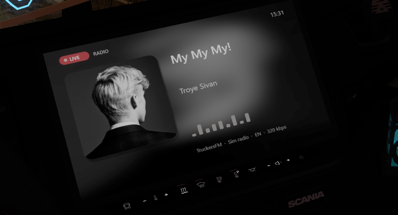
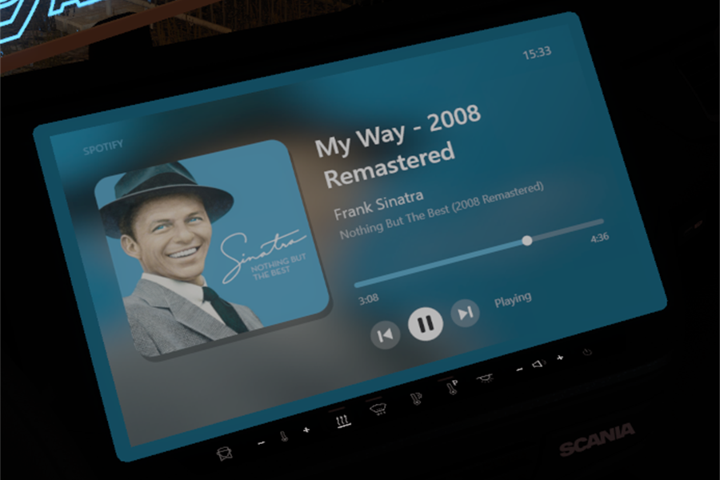

<h1 align="center">EtsNowPlaying</h1>

<p align="center">
  <strong>Sieh auf dem GPS-Display deines Trucks, was du gerade hörst.</strong><br>
  Für Euro Truck Simulator 2 und American Truck Simulator: Spielradio und Spotify, direkt in der Kabine.
</p>

<p align="center">
  <a href="https://github.com/jxhnch/EtsNowPlaying/releases/latest"></a>
  <a href="https://github.com/jxhnch/EtsNowPlaying/releases"></a>
  
  <a href="LICENSE"></a>
</p>

<p align="center">
  <a href="https://github.com/jxhnch/EtsNowPlaying/releases/latest/download/EtsNowPlaying.dll"></a>
</p>

<p align="center">
  <a href="README.md">English</a> · <b>Deutsch</b>
</p>

<p align="center">
  <a href="docs/images/radio.png"></a>
  <a href="docs/images/spotify.png"></a>
</p>

<p align="center">
  <a href="#funktionen">Funktionen</a> ·
  <a href="#installieren">Installieren</a> ·
  <a href="#bedienung">Bedienung</a> ·
  <a href="#einstellungen">Einstellungen</a> ·
  <a href="#probleme">Hilfe</a> ·
  <a href="#datenschutz--nutzungsbedingungen">Datenschutz</a>
</p>

## Funktionen

| | |
|---|---|
| **Radio** | Sender, Song und Interpret aus dem Spielradio, mit Song-Cover, Senderlogo oder deinem eigenen Bild |
| **Spotify und andere Player** | Cover, Titel, Interpret, Album, Fortschrittsbalken und Play/Pause. Der Player kann im Hintergrund bleiben |
| **Schaltet selbst um** | Radio an zeigt das Radio, Radio aus zeigt deinen Musik-Player |
| **Klicken zum Steuern** | Zurück, Play/Pause, Weiter und Spulen mit der Maus, direkt auf dem Display |
| **Passt in jede Kabine** | Das Bild passt sich an das Display jedes Fahrzeugs an, nichts pro Truck einstellen |
| **Eine Datei** | Nichts weiter zu installieren. Funktioniert mit TruckersMP |

## Installieren

1. Spiel beenden.
2. [**`EtsNowPlaying.dll`** herunterladen](https://github.com/jxhnch/EtsNowPlaying/releases/latest/download/EtsNowPlaying.dll) (alle Versionen findest du unter [Releases](https://github.com/jxhnch/EtsNowPlaying/releases)).
3. In den `plugins`-Ordner des Spiels legen. Gibt es ihn noch nicht, lege ihn an. Bei ETS2:

   ```text
   ...\Steam\steamapps\common\Euro Truck Simulator 2\bin\win_x64\plugins\
   ```

   Bei ATS ist es derselbe Ordner `bin\win_x64\plugins\` innerhalb von `American Truck Simulator`.

4. Spiel starten, Profil laden und in die Kabine setzen. Das neue Display ersetzt das GPS.

> [!TIP]
> Du siehst noch das normale GPS? Starte das Spiel einmal neu. Das Plugin richtet sich beim ersten Start selbst ein.

> [!IMPORTANT]
> Entferne vorher andere Plugins, die das GPS-Display verändern. Sie würden sich gegenseitig stören.

## Bedienung

| Du willst | Das tust du |
|---|---|
| **Spotify** | Einfach etwas abspielen |
| **Einen anderen Player** | [`app_filter`](#einstellungen) ändern |
| **Radio** | Das Radio im Spiel einschalten |
| **Zurück, Play/Pause, Weiter** | Auf dem Truck-Display ⏮ ⏯ ⏭ anklicken |
| **Vor- und zurückspulen** (Spotify) | Auf den Fortschrittsbalken klicken oder ihn ziehen |

Zum Klicken muss der Mauszeiger in der Kabine sichtbar sein (rechte Maustaste nicht gedrückt halten).

Apple Music, Deezer, Tidal und Amazon Music werden mit ihrem Namen angezeigt. Die Player werden über die Windows-Mediensteuerung ausgelesen.

Beim Radio kommen die Songtitel aus dem Stream selbst. Einige Sender senden keine Titel und zeigen nur ihren Namen, siehe [zusätzliche Song-Quellen](#zusätzliche-song-quellen).

## Einstellungen

Die Datei wird beim ersten Start angelegt (bei ATS im Ordner `American Truck Simulator`):

```text
Dokumente\Euro Truck Simulator 2\EtsNowPlaying\EtsNowPlaying.ini
```

| Einstellung | Standard | Wirkung |
|---|---|---|
| `[screen] auto_fit` | `1` | Bild an das Display jedes Fahrzeugs anpassen. `0` = aus |
| `[screen] flip_vertical` | `1` | Auf `0` setzen, wenn das Bild kopfsteht (nur bei `auto_fit=0`) |
| `[media] app_filter` | `spotify` | Nur diese App zeigen (Teil ihres Namens). Leer = jeder Mediaplayer |
| `[radio] cover_lookup` | `1` | Song-Cover und Senderlogos online suchen. `0` = aus |
| `[radio] cover_mode` | `cover` | `cover` = Song-Cover, oder das Senderlogo, wenn keins gefunden wird. `logo` = immer das Senderlogo |
| `[radio] extra_sources` | `1` | Die optionale Datei `EtsNowPlaying.sources.ini` benutzen. `0` = nie |
| `[touch] enabled` | `1` | Maus-Tasten auf dem Display. `0` = aus |

## Cover, Logos und eigene Bilder

Beim Radio zeigt das Plugin das erste, was es davon hat:

1. Das **Cover** des Songs, online nach Interpret und Titel gesucht. Kurze Titel müssen genau passen, fremde Cover sind deshalb selten. Entfällt mit `cover_mode=logo`.
2. Das **Logo** des Senders von radio-browser.info.
3. Die **Anfangsbuchstaben** des Senders.

**Dein eigenes Bild** für einen Sender ohne Logo oder mit falschem: Benenne die Datei wie den Sender, zum Beispiel `Real Hardstyle.png`, und lege sie hier ab:

```text
Dokumente\Euro Truck Simulator 2\EtsNowPlaying\logos\custom\
```

- Der Name ist der Sendername aus deiner `live_streams.sii`. Groß- und Kleinschreibung ist egal.
- PNG, JPG, WEBP, GIF, BMP und ICO gehen.
- Dein Bild ersetzt das Online-Logo. Es wird nur von deinem PC gelesen und geht auch mit `cover_lookup=0`.
- Nach dem Hinzufügen das Spiel neu starten. Das Plugin legt den Ordner mit einer kurzen Notiz beim ersten Start an.

## Zusätzliche Song-Quellen

*Optional.* Manche Sender senden in ihrem Stream nur den Namen einer **Show**, nicht den Song (Real Hardstyle Radio macht das während seiner Shows). Bietet so ein Sender den aktuellen Song zusätzlich unter einer Web-Adresse an, kannst du ihn in `EtsNowPlaying.sources.ini` eintragen, neben der Einstellungsdatei.

<details>
<summary><b>So fügst du eine Quelle hinzu</b></summary>
<br>

Das Plugin legt die Datei beim ersten Start an, mit einem Eintrag für Real Hardstyle Radio. Pro Eintrag gibst du an, woran man den Sender erkennt (`match`), wo gefragt wird (`url`) und wo in der Antwort der Song steht (`title`, optional `artist`):

```ini
[Real Hardstyle]
enabled=1
match=realhardstyle|real hardstyle
url=https://api.realhardstyle.com/get/nowplaying
title=response.activeSession.rawTitle
interval=10
```

Die Adresse wird nur abgefragt, solange der Sender läuft (standardmäßig alle 10 Sekunden). Liefert sie keinen Song oder ist sie nicht erreichbar, bleibt es beim Titel aus dem Stream. Trägt der Stream den Song schon mit, bleibt dessen Interpret erhalten.

Mit `enabled=0` schaltest du einen Eintrag ab, mit `extra_sources=0` in der Einstellungsdatei alle.

**Real Hardstyle spielt gar nicht?** Das Spiel kann der https-Weiterleitung von `https://stream.realhardstyle.nl/` nicht folgen. Trage stattdessen diese Adresse in der `live_streams.sii` ein:

```text
http://server-23.stream-server.nl:8326/
```

</details>

## Probleme?

Bitte [eröffne ein Issue](https://github.com/jxhnch/EtsNowPlaying/issues) und hänge die Log-Datei an:

```text
Dokumente\Euro Truck Simulator 2\EtsNowPlaying\diag.log
```

**Nach einem Spiel-Update:** Eine neue Spielversion kann etwas verschieben, worauf das Plugin sich stützt. Dann lässt das Plugin das normale GPS in Ruhe (oder schaltet es wieder ein) und sagt es dir in einem kleinen Fenster (einmal pro Spielversion). Schau unter [Releases](https://github.com/jxhnch/EtsNowPlaying/releases) nach einem Update. Gibt es noch keins, eröffne ein Issue mit der Log-Datei.

## Selbst bauen

Du brauchst die Visual Studio 2022 Build Tools (C++). Führe `build.bat` aus. Das Plugin liegt dann unter `build\EtsNowPlaying.dll`.

Enthalten sind [MinHook](https://github.com/TsudaKageyu/minhook) und die SCS-SDK-Header, siehe [THIRD_PARTY_NOTICES.md](THIRD_PARTY_NOTICES.md).

## Datenschutz & Nutzungsbedingungen

**Datenschutz.** EtsNowPlaying hat keine Konten, keine Analyse und keine eigene Telemetrie. Es liest den Radio-Stream des Spiels und die Windows-Mediensteuerung auf deinem PC aus. Für Cover, Logos und zusätzliche Song-Quellen stellt es diese Web-Anfragen:

| Zweck | Empfänger | Was gesendet wird | Abschalten |
|---|---|---|---|
| Cover zum Radio-Song | iTunes Search (Apple) und Deezer | Interpret und Songtitel | `cover_lookup=0` oder `cover_mode=logo` |
| Senderlogo | radio-browser.info | Sendername, Stream-Adresse und, falls deine Senderliste dafür ein zweistelliges Kürzel enthält, dieses Kürzel | `cover_lookup=0` |
| Bild herunterladen | Der Server, auf dem das Bild liegt. Bei Logos ist das die Adresse, die radio-browser.info nennt | Eine Anfrage nach dem Bild | `cover_lookup=0` |
| Zusätzliche Song-Quelle, nur solange der Sender läuft (alle paar Sekunden) | Die Adresse in `EtsNowPlaying.sources.ini` (eine für Real Hardstyle Radio ist enthalten und aktiv) | Eine Anfrage ohne Daten über dich | `extra_sources=0`, oder `enabled=0` beim Eintrag |

Wie bei jeder Web-Anfrage sieht jeder dieser Server deine IP-Adresse. Persönliche Daten, Spieldaten oder Spotify-Daten werden nicht gesendet.

**Um alle diese Online-Anfragen abzuschalten, setze `cover_lookup=0` und `extra_sources=0`.** Deine eigenen Bilder in `logos\custom` verlassen nie deinen PC. Logos werden in `Dokumente\Euro Truck Simulator 2\EtsNowPlaying\logos` zwischengespeichert, und `diag.log` bleibt auf deinem PC, solange du sie nicht selbst verschickst.

**Bedingungen.** Freie Software unter der [MIT-Lizenz](LICENSE), „wie besehen“ und ohne Gewähr. Das Plugin verändert Spielcode im Speicher: Nutzung auf eigenes Risiko, und die Regeln der Server, auf denen du spielst (z. B. TruckersMP), gelten weiter. Cover und Logos gehören ihren Rechteinhabern und werden nur angezeigt, nicht darüber hinaus gespeichert (außer dem Logo-Cache); für deren Daten gelten die Bedingungen von iTunes, Deezer und radio-browser.info. Keine Verbindung zu SCS Software, TruckersMP, Spotify, Apple, Deezer, Tidal oder Amazon.

[MIT-Lizenz](LICENSE)
