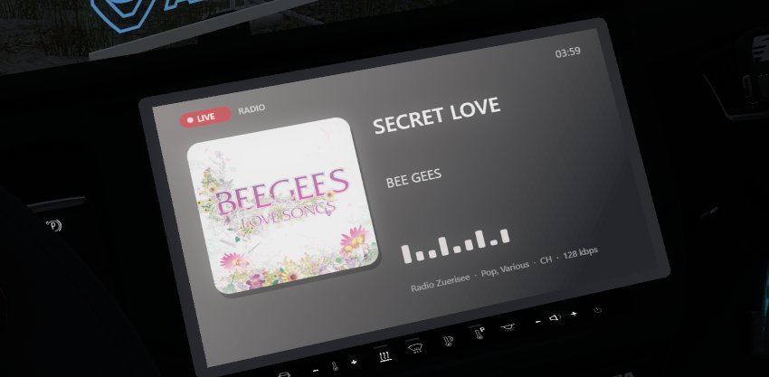
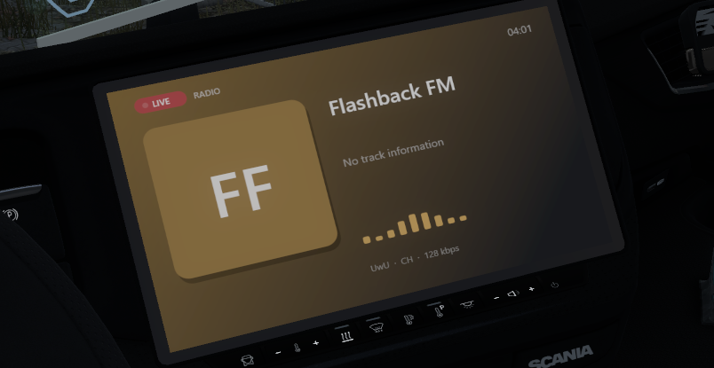

# EtsNowPlaying

**Ein „Now Playing“-Display für die Kabine von Euro Truck Simulator 2 und American Truck Simulator.**
Das GPS-Display deines Trucks zeigt, was du gerade hörst: das **Internetradio im Spiel** (Sender, Song, Interpret, Cover)
oder **Spotify** (Cover, Titel, Interpret, Fortschritt) – über die Windows-Mediensteuerung, nicht per abgefilmtem Fenster.

*[English](README.md) · Deutsch*

<p align="center">
  
  
</p>

## Funktionen

- **Radio:** zeigt Song, Interpret und Album-Cover des Senders, den du im Spielradio hörst. Der Titel kommt direkt aus dem
  Stream, den das Spiel abspielt, passt also immer zu dem, was du hörst.
- **Spotify (und andere):** Cover, Titel, Interpret, Album, Fortschrittsbalken mit Zeit und Play/Pause – über die
  Windows-Mediensteuerung (SMTC). Das Spotify-Fenster kann versteckt bleiben.
- **Automatisches Umschalten:** Radio an → Radio-Anzeige, Radio aus oder pausiert → zurück zu Spotify. Beim Senderwechsel flackert nichts.
- **Cover bestimmt das Design:** Der Hintergrund ist das weichgezeichnete Cover, Akzentfarben werden daraus gezogen.
- **Eine Datei:** eine einzige DLL. Keine Zusatz-App, keine Installationen, kein .NET oder C++-Runtime nötig.
- **Abgesichert:** Stürzt das Spiel einmal ab, schaltet sich das Plugin beim nächsten Start Schritt für Schritt zurück.
- **Getestet mit TruckersMP** und im Einzelspieler. Alles läuft auf deinem Rechner.

## Voraussetzungen

- Windows 10 oder 11
- Euro Truck Simulator 2 (getestet mit 1.61.1.9, DirectX 11) – American Truck Simulator nutzt dieselbe Engine, ist aber ungetestet
- Spotify-Desktop-App (optional; jede App aus dem Windows-Medienoverlay geht, siehe `app_filter`)

## Installation

1. Spiel beenden.
2. `EtsNowPlaying.dll` von der Seite [Releases](../../releases) holen, sobald es ein Release gibt, oder [selbst bauen](#selbst-bauen).
3. In den Plugin-Ordner des Spiels kopieren, meist  
   `C:\Program Files (x86)\Steam\steamapps\common\Euro Truck Simulator 2\bin\win_x64\plugins\`
4. Spiel starten, Profil laden und in die Kabine setzen. Beim allerersten Start legt das Plugin zwei kleine Dateien an unter  
   `Dokumente\Euro Truck Simulator 2\EtsNowPlaying\` – ist das GPS danach noch normal, starte das Spiel einmal neu.

Hast du ein anderes GPS-Display-Plugin (z. B. *PrismTextureStreamer*) installiert, entferne es vorher: Beide wollen dieselbe Textur.

Die Anzeige ersetzt das **GPS**-Display des Trucks. Die Sender kommen aus deiner `live_streams.sii`, eigene Sender funktionieren also auch.

## Einstellungen

Die Datei liegt unter `Dokumente\Euro Truck Simulator 2\EtsNowPlaying\EtsNowPlaying.ini` (wird beim ersten Start angelegt).

| Bereich / Schlüssel | Standard | Bedeutung |
|---|---|---|
| `[screen] flip_vertical` | `1` | Auf `0` setzen, wenn das Bild bei deinem Truck kopfsteht. |
| `[media] app_filter` | `spotify` | Nur Medien von Apps zeigen, deren Name diesen Text enthält. Leer = jeder Player. |
| `[radio] cover_lookup` | `1` | Song-Cover für Radiotitel suchen (siehe [Datenschutz](#datenschutz)). `0` schaltet es ab. |
| `[radio] pause_after_ms` | `2500` | So lange keine Stream-Daten = Radio pausiert (passt sich dem Stream an). |
| `[radio] switch_hold_ms` | `600` | So lange bleibt die Radio-Anzeige nach Ende eines Streams, damit Senderwechsel nicht kurz Spotify zeigen. |
| `[features] force_stage` | `-1` | `-1` = automatischer Absturz-Rückfall. `0..3` erzwingt eine [Stufe](#abgesicherter-modus). |

## So funktioniert es

Das Plugin ist ein normales SCS-Telemetrie-Plugin und macht vier Dinge im Spielprozess:

1. **Bildschirm-Textur.** Das Spiel lädt die GPS-Textur; das Plugin biegt die Anfrage auf einen winzigen Platzhalter um
   (ein 64×2048-Bild, das es selbst schreibt). Bindet das Spiel den Platzhalter an einen Shader, tauscht das Plugin seine eigene
   Textur ein, die es mit einem Direct2D-/DirectWrite-Bild füllt. Die GPS-Oberfläche des Spiels wird abgeschaltet.
2. **Radio.** Die Audio-Engine des Spiels (FMOD) öffnet Radio-Streams über normale HTTP-Sockets. Das Plugin beobachtet diese
   Verbindungen, ordnet die URL deiner `live_streams.sii` zu und liest die ICY-Metadaten (`StreamTitle`) aus dem Stream.
   Es wird nichts in den Stream eingefügt und dafür nichts zusätzlich heruntergeladen.
3. **Spotify.** Die Windows-API *System Media Transport Controls* liefert Titel, Interpret, Cover und Position.
4. **Cover für Radio-Songs.** Sendet der Sender `Interpret - Song`, fragt das Plugin die iTunes-Suche nach dem Cover.

Die Engine-Hooks werden über Byte-Signaturen gefunden und überleben die meisten Spiel-Updates. Passt eine Signatur nach einem großen
Update nicht mehr, bleibt das Plugin einfach passiv und schreibt den Grund ins Log.

## Abgesicherter Modus

Hooks in einem Spiel können mit manchen Treiber-/Spiel-Kombinationen schiefgehen. Das Plugin merkt sich, ob die letzte Sitzung sauber
endete. Nach einem Absturz geht es beim nächsten Start einen Schritt zurück:

| Stufe | Was an ist |
|---|---|
| 0 | alles |
| 1 | kein Bild-Upload (Textur getauscht, aber nicht gefüllt) |
| 2 | zusätzlich bleibt die GPS-Oberfläche des Spiels an |
| 3 | Anzeige aus, nur Logging |

Ein sauberes Beenden behält die Stufe; lösche `state.ini` (oder setze `force_stage=0`), um zu Stufe 0 zurückzukehren.
Falls das bei dir passiert, hänge bitte `diag.log` und `diag.prev.log` an ein Issue.

## Datenschutz

- Keine Telemetrie, keine Konten. Das Plugin schickt deinen Hörverlauf nirgendwohin.
- Mit `cover_lookup=1` sendet es den aktuellen Radio-**Titel** (z. B. `Interpret - Song`) an `itunes.apple.com` und lädt das Cover
  von Apples Bildservern. Abschalten mit `cover_lookup=0`.
- Alles andere (Radiotitel, Spotify-Infos) bleibt auf deinem Rechner. Logs sind lokale Dateien im Dokumente-Ordner des Plugins.

## Fehlersuche

- **Bildschirm ist das normale GPS / schwarz:** Spiel einmal neu starten; im `diag.log` Zeilen mit `ENGINE` und `SCREEN` ansehen.
- **Kopfüber oder gespiegelt:** `flip_vertical` in der ini ändern.
- **Radio zeigt den Sendernamen statt eines Songs:** Viele Sender schicken keine Titel (oder erst nach ein paar Sekunden). Die Anzeige
  sagt das. Das Plugin kann nur zeigen, was der Stream enthält.
- **Radio wird gar nicht erkannt:** `diag.log` listet jede Radio-Verbindung (`RADIO request/response`).
- **Spotify wird nicht angezeigt:** Das Windows-Medienoverlay muss es listen; prüfe `[media] app_filter`.

## Selbst bauen

Braucht die Visual Studio 2022 Build Tools (C++-Workload, CMake und Ninja sind dabei).

```bat
build.bat
```

erzeugt `build\EtsNowPlaying.dll`. `deploy.ps1` kopiert sie in den Plugin-Ordner des Spiels
(`-DisableOld` schiebt ein früheres Display-Plugin weg, `-Uninstall` entfernt das Plugin wieder).

Abhängigkeiten liegen im Repo: [MinHook](https://github.com/TsudaKageyu/minhook) (BSD-2-Clause) und die Header des
[SCS-Software-SDK](https://modding.scssoft.com/wiki/Documentation/Engine/SDK/Telemetry). Siehe [THIRD_PARTY_NOTICES.md](THIRD_PARTY_NOTICES.md).

## Branches

- `main` – stabil.
- `beta/touch` – experimentell: das Display in der Kabine mit der Maus bedienen.

## Hinweis

Nicht verbunden mit oder unterstützt von SCS Software, TruckersMP, Spotify oder Apple. Das Plugin ändert Spielcode im Speicher;
Nutzung auf eigenes Risiko, besonders im Multiplayer, und beachte die Regeln der Server, auf denen du spielst.

## Lizenz

[MIT](LICENSE)
