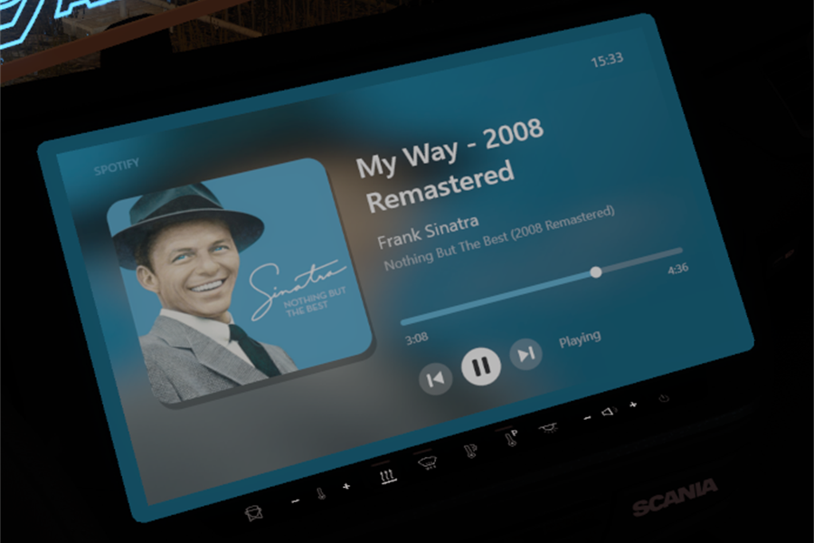

<h1 align="center">EtsNowPlaying</h1>

<p align="center">
  <strong>See what you are listening to on your truck's GPS screen.</strong><br>
  For Euro Truck Simulator 2 and American Truck Simulator: in-game radio and Spotify, right in the cabin.
</p>

<p align="center">
  <a href="https://github.com/jxhnch/EtsNowPlaying/releases/latest"></a>
  <a href="https://github.com/jxhnch/EtsNowPlaying/releases"></a>
  
  <a href="LICENSE"></a>
</p>

<p align="center">
  <a href="https://github.com/jxhnch/EtsNowPlaying/releases/latest/download/EtsNowPlaying.dll"></a>
</p>

<p align="center">
  <b>English</b> · <a href="README.de.md">Deutsch</a>
</p>

<p align="center">
  <a href="docs/images/radio.png"></a>
  <a href="docs/images/spotify.png"></a>
</p>

<p align="center">
  <a href="#features">Features</a> ·
  <a href="#install">Install</a> ·
  <a href="#controls">Controls</a> ·
  <a href="#settings">Settings</a> ·
  <a href="#something-wrong">Help</a> ·
  <a href="#privacy-policy--terms-of-use">Privacy</a>
</p>

## Features

| | |
|---|---|
| **Radio** | Station, song and artist from the game's radio, with the song cover, the station logo or your own picture |
| **Spotify and other players** | Cover, title, artist, album, progress bar and play/pause. The player can stay in the background |
| **Switches by itself** | Radio on shows the radio, radio off shows your music player |
| **Click to control** | Previous, play/pause, next and seeking, with the mouse, right on the screen |
| **Fits every cabin** | The picture adapts to each vehicle's display, no setup per truck |
| **One file** | Nothing else to install. Works with TruckersMP |

## Install

1. Close the game.
2. [Download **`EtsNowPlaying.dll`**](https://github.com/jxhnch/EtsNowPlaying/releases/latest/download/EtsNowPlaying.dll) (all versions are on the [Releases](https://github.com/jxhnch/EtsNowPlaying/releases) page).
3. Put it into the game's `plugins` folder. Create the folder if it does not exist. For ETS2:

   ```text
   ...\Steam\steamapps\common\Euro Truck Simulator 2\bin\win_x64\plugins\
   ```

   For ATS, use the same `bin\win_x64\plugins\` folder inside `American Truck Simulator`.

4. Start the game, load your profile and sit in the cabin. The new screen replaces the GPS display.

> [!TIP]
> Still seeing the normal GPS? Restart the game once. The plugin sets itself up on the first start.

> [!IMPORTANT]
> Remove other plugins that change the GPS screen first. They would get in each other's way.

## Controls

| You want | Do this |
|---|---|
| **Spotify** | Just play something |
| **Another player** | Change [`app_filter`](#settings) |
| **Radio** | Switch on the radio in the game |
| **Previous, play/pause, next** | Click ⏮ ⏯ ⏭ on the truck screen |
| **Rewind or fast-forward** (Spotify) | Click or drag on the progress bar |

To click, the mouse pointer has to be visible in the cabin (don't hold the right mouse button).

Apple Music, Deezer, Tidal and Amazon Music are shown with their own names. Players are read through the Windows media controls.

Song titles for radio come from the stream itself. A few stations send no titles and only show their name, see [extra song sources](#extra-song-sources).

## Settings

The file is created on the first start (for ATS in the `American Truck Simulator` folder):

```text
Documents\Euro Truck Simulator 2\EtsNowPlaying\EtsNowPlaying.ini
```

| Setting | Default | What it does |
|---|---|---|
| `[screen] auto_fit` | `1` | Fit the picture to each vehicle's display. `0` = off |
| `[screen] flip_vertical` | `1` | Set `0` if the picture is upside down (only used when `auto_fit=0`) |
| `[media] app_filter` | `spotify` | Only show this app (part of its name). Empty = any media player |
| `[radio] cover_lookup` | `1` | Look up song covers and station logos online. `0` = off |
| `[radio] cover_mode` | `cover` | `cover` = song covers, or the station logo when none is found. `logo` = always the station logo |
| `[radio] extra_sources` | `1` | Use the optional file `EtsNowPlaying.sources.ini`. `0` = never |
| `[touch] enabled` | `1` | Mouse buttons on the screen. `0` = off |

## Covers, logos and your own pictures

For radio, the plugin shows the first of these it has:

1. The song's **cover**, found online by artist and title. Short titles must match exactly, so unrelated covers are rare. Skipped with `cover_mode=logo`.
2. The station's **logo** from radio-browser.info.
3. The station's **initials**.

**Your own picture** for a station without a logo, or with a wrong one: name the file like the station, for example `Real Hardstyle.png`, and put it here:

```text
Documents\Euro Truck Simulator 2\EtsNowPlaying\logos\custom\
```

- The name is the station name from your `live_streams.sii`. Upper and lower case do not matter.
- PNG, JPG, WEBP, GIF, BMP and ICO work.
- Your picture replaces the online logo. It is read from your PC only and also works with `cover_lookup=0`.
- Restart the game after adding a file. The plugin creates the folder, with a short note, on the first start.

## Extra song sources

*Optional.* Some stations only send the name of a **show** in their stream, not the song (Real Hardstyle Radio does this during its shows). If such a station also offers the current song on a web address, you can add it to `EtsNowPlaying.sources.ini`, next to the settings file.

<details>
<summary><b>How to add a source</b></summary>
<br>

The plugin creates the file on the first start, with one entry for Real Hardstyle Radio. For every entry you say how to recognise the station (`match`), where to ask (`url`) and where the song is inside the answer (`title`, optionally `artist`):

```ini
[Real Hardstyle]
enabled=1
match=realhardstyle|real hardstyle
url=https://api.realhardstyle.com/get/nowplaying
title=response.activeSession.rawTitle
interval=10
```

The address is only asked while the station is playing (every 10 seconds by default). If it gives no song or cannot be reached, the title from the stream is shown as usual. If the stream already carries the song, its artist is kept.

Set `enabled=0` to switch off one entry, or `extra_sources=0` in the settings file to switch off all of them.

**Real Hardstyle does not play at all?** The game cannot follow the https redirect of `https://stream.realhardstyle.nl/`. Use this address in `live_streams.sii` instead:

```text
http://server-23.stream-server.nl:8326/
```

</details>

## Something wrong?

Please [open an issue](https://github.com/jxhnch/EtsNowPlaying/issues) and attach the log file:

```text
Documents\Euro Truck Simulator 2\EtsNowPlaying\diag.log
```

**After a game update:** a new game version can move something the plugin relies on. The plugin then leaves (or puts back) the normal GPS and tells you in a small window ("does not support this game version yet", once per game version). Check the [Releases](https://github.com/jxhnch/EtsNowPlaying/releases) page for an update. If there is none yet, open an issue with the log.

## Build it yourself

You need the Visual Studio 2022 Build Tools (C++). Run `build.bat`. The plugin is then in `build\EtsNowPlaying.dll`.

Included are [MinHook](https://github.com/TsudaKageyu/minhook) and the SCS SDK headers, see [THIRD_PARTY_NOTICES.md](THIRD_PARTY_NOTICES.md).

## Privacy Policy & Terms of Use

**Privacy.** EtsNowPlaying has no accounts, no analytics and no telemetry of its own. It reads what is playing from the game's radio stream and the Windows media controls on your PC. For covers, logos and extra song sources it makes these web requests:

| Purpose | Sent to | What is sent | Switch off |
|---|---|---|---|
| Radio song cover | iTunes Search (Apple) and Deezer | Artist and song title | `cover_lookup=0` or `cover_mode=logo` |
| Station logo | radio-browser.info | Station name, stream address and, if your station list has a two-letter code for it, that code | `cover_lookup=0` |
| Image download | The server hosting the image. For logos, this is the address listed by radio-browser.info | A request for the image | `cover_lookup=0` |
| Extra song source, only while that station plays (every few seconds) | The address in `EtsNowPlaying.sources.ini` (one for Real Hardstyle Radio is included and enabled) | A request without data about you | `extra_sources=0`, or `enabled=0` for the entry |

As with any web request, each of these servers sees your IP address. No personal data, game data or Spotify data is sent.

**To switch off all of these online requests, set both `cover_lookup=0` and `extra_sources=0`.** Your own pictures in `logos\custom` never leave your PC. Logos are cached in `Documents\Euro Truck Simulator 2\EtsNowPlaying\logos`, and `diag.log` stays on your PC unless you send it yourself.

**Terms.** Free software under the [MIT License](LICENSE), provided "as is" without warranty. The plugin changes game code in memory: use it at your own risk and follow the rules of the servers you play on (e.g. TruckersMP). Covers and logos belong to their rights holders and are only displayed, not stored beyond the logo cache; the terms of iTunes, Deezer and radio-browser.info apply to their data. Not affiliated with SCS Software, TruckersMP, Spotify, Apple, Deezer, Tidal or Amazon.

[MIT License](LICENSE)
