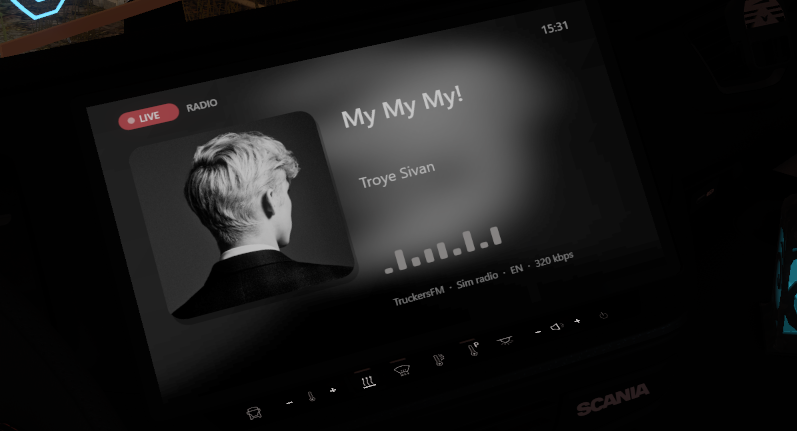
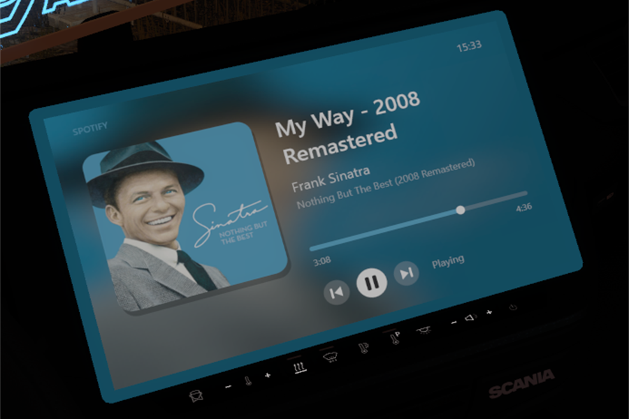

# EtsNowPlaying

**See what you are listening to on your truck's GPS screen** – in Euro Truck Simulator 2 and American Truck Simulator.
The in-game **radio** (station, song, artist, cover) or **Spotify** (cover, title, artist, progress), and you can click
previous / pause / next right in the cabin.

*English · [Deutsch](README.de.md)*

<p align="center">
  
  
</p>

## What you get

- **Radio:** the song, artist and cover of the station you hear in the game's radio, plus the station's logo.
- **Spotify:** cover, title, artist, album, a progress bar and play/pause – shown from the Windows media controls,
  so Spotify can stay in the background.
- **Switches by itself:** radio on → radio, radio off → Spotify.
- **Click to control:** previous, play/pause and next work with the mouse, right on the screen. Click or drag the progress bar to
  jump around in the song.
- **Fits every cabin:** the picture adapts to the shape of each vehicle's display by itself – no setup per truck.
- **One file.** Nothing else to install. Works with TruckersMP.

## Install

1. Close the game.
2. Download **`EtsNowPlaying.dll`** from the [Releases](../../releases) page.
3. Put it into the game's `plugins` folder:  
   `...\Steam\steamapps\common\Euro Truck Simulator 2\bin\win_x64\plugins\`
4. Start the game, load your profile and sit in the cabin. The new screen replaces the GPS display.  
   If you still see the normal GPS, restart the game once (the plugin sets itself up on the first start).

Remove other plugins that change the GPS screen first, they would get in each other's way.

## Use

- **Spotify:** just play something.
- **Radio:** switch on the radio in the game. Song titles come from the radio stream itself, so a few stations that do not
  send titles only show their name.
- **Buttons:** with the mouse pointer visible in the cabin (don't hold the right mouse button), click ⏮ ⏯ ⏭ on the screen.
  Click or drag on the progress bar to rewind / fast-forward (Spotify).

## Settings

`Documents\Euro Truck Simulator 2\EtsNowPlaying\EtsNowPlaying.ini` is created on the first start:

| Setting | Default | |
|---|---|---|
| `[screen] flip_vertical` | `1` | Set `0` if the picture is upside down. (Only used when `auto_fit=0`.) |
| `[screen] auto_fit` | `1` | Fit the picture to each vehicle's display. `0` = off. |
| `[media] app_filter` | `spotify` | Only show this app. Empty = any media player. |
| `[radio] cover_lookup` | `1` | Look up song covers and station logos online. `0` = off. |
| `[radio] cover_mode` | `cover` | `cover` = song covers (the station's logo when none is found). `logo` = always the station's logo, never a song cover. |
| `[radio] extra_sources` | `1` | Use the optional file `EtsNowPlaying.sources.ini` (see below). `0` = never. |
| `[touch] enabled` | `1` | Mouse buttons on the screen. `0` = off. |

## Your own station pictures

A station without a logo (or with a wrong one) can get its own picture: put a file named like the station into
`Documents\Euro Truck Simulator 2\EtsNowPlaying\logos\custom\`, for example `Real Hardstyle.png` (the name is the station
name from your `live_streams.sii`, upper/lower case does not matter; PNG, JPG, WEBP, GIF, BMP and ICO work). Your picture
wins over the logo from radio-browser.info and needs no internet. With `cover_mode=logo` it is the only picture shown for that
station. Restart the game after adding a file.

## Optional: extra song sources

A few stations only send the name of a *show* in their stream, not the song (Real Hardstyle Radio does this during its shows).
If such a station also offers the current song on a web address, it can be listed in
`Documents\Euro Truck Simulator 2\EtsNowPlaying\EtsNowPlaying.sources.ini`. The plugin creates this file on the first start,
**it is optional** and comes with one entry for Real Hardstyle Radio. For every entry you say how to recognise the station
(`match`), where to ask (`url`) and where the song is inside the answer (`title`, optionally `artist`):

```ini
[Real Hardstyle]
enabled=1
match=realhardstyle|real hardstyle
url=https://api.realhardstyle.com/get/nowplaying
title=response.activeSession.rawTitle
interval=10
```

The plugin asks that address only while the station is playing (every 10 seconds by default). If the address gives no song,
or cannot be reached, the title from the stream is shown as usual. Set `enabled=0` for an entry, or `extra_sources=0` in the
INI to switch it all off.

## Privacy

No tracking, no accounts. With `cover_lookup=1` the plugin sends the current radio *title* and the *station name*
to iTunes, Deezer and radio-browser.info to find a cover or logo. Nothing else leaves your PC. Set it to `0` to switch this off.
The optional sources file (see above) makes the plugin also ask the listed web address while that station plays; that
address sees your IP address like any website. `extra_sources=0` switches this off.

## Something wrong?

The plugin writes `Documents\Euro Truck Simulator 2\EtsNowPlaying\diag.log`. If you report a problem, please attach it.

**After a game update:** a new game version can move something the plugin relies on. Then the plugin leaves (or puts back) the
game's normal GPS and tells you with a small window ("does not support this game version yet", shown once per game version). Check the
[Releases](../../releases) page for a plugin update; if there is none yet, please open an issue and attach the log.

## Build it yourself

You need the Visual Studio 2022 Build Tools (C++). Run `build.bat`; the plugin is `build\EtsNowPlaying.dll`.
Included: [MinHook](https://github.com/TsudaKageyu/minhook) and the SCS SDK headers, see
[THIRD_PARTY_NOTICES.md](THIRD_PARTY_NOTICES.md).

## Disclaimer

Not affiliated with SCS Software, TruckersMP, Spotify, Apple or Deezer. The plugin changes game code in memory – use it at your
own risk and follow the rules of the servers you play on.

## Privacy Policy & Terms of Use

**Privacy.** EtsNowPlaying has no accounts, no analytics and no telemetry of its own. It reads what is playing from the game's
radio stream and the Windows media controls on your PC. With `[radio] cover_lookup=1` (the default) it sends the **current radio
song title and the station name** to **iTunes Search (Apple), Deezer and radio-browser.info** to find a cover or logo; like any web
request, these services see your IP address. Nothing else is sent: no personal data, no game data, no Spotify data. Set
`cover_lookup=0` to switch off all online requests. Logos are cached in `Documents\Euro Truck Simulator 2\EtsNowPlaying\logos`,
and `diag.log` stays on your PC unless you send it yourself. If an entry of the optional file `EtsNowPlaying.sources.ini` is
enabled (one for Real Hardstyle Radio is included), the plugin also requests the web address listed there every few seconds, but only
while that station is playing; the request contains no data about you, and the server sees your IP address. Set
`[radio] extra_sources=0` or `enabled=0` to switch this off.

**Terms.** Free software under the [MIT License](LICENSE), provided "as is" without warranty. The plugin changes game code in
memory: use it at your own risk and follow the rules of the servers you play on (e.g. TruckersMP). Covers and logos belong to their
rights holders and are only displayed, not stored beyond the logo cache; the terms of iTunes, Deezer and radio-browser.info apply
to their data. Not affiliated with SCS Software, TruckersMP, Spotify, Apple or Deezer.

[MIT License](LICENSE)
